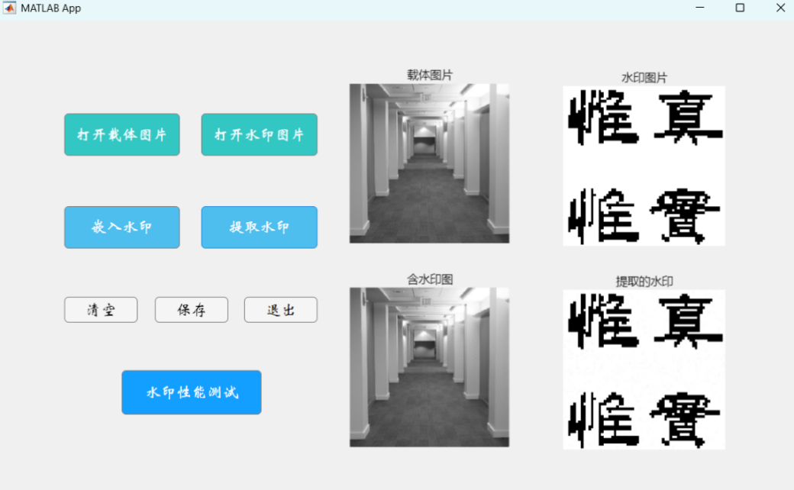
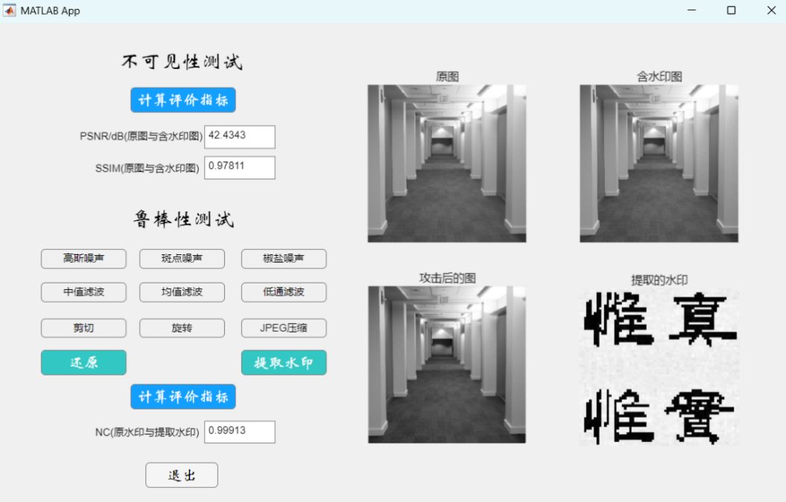
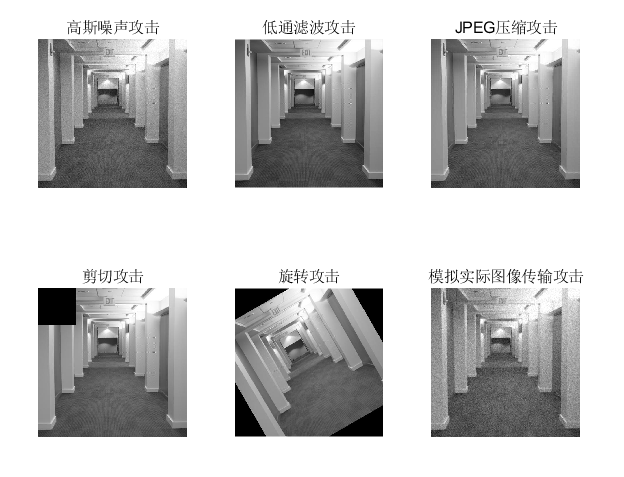

# MATLAB 数字图像水印系统

[English](README.en.md)

这是一个基于 MATLAB App Designer 的图像数字水印毕业设计项目。主程序实现了基于 **Haar 小波变换（DWT）、离散余弦变换（DCT）和奇异值分解（SVD）** 的灰度图像水印嵌入与提取，并提供噪声、滤波、裁剪、旋转和 JPEG 压缩等实验操作。

## 功能一览

- 在载体图像中嵌入并提取二值水印
- 通过 Arnold 变换对水印进行置乱预处理
- 显示原图、含水印图和提取出的水印
- 计算 PSNR、SSIM 和归一化相关系数（NC）
- 对含水印图像进行多种常见攻击并观察提取结果
- 附带 DCT、DWT、SVD、Arnold 和 Logistic 混沌等 MATLAB 实验文件

## 界面与运行效果

主界面展示载体图像、水印图像、含水印图像和提取结果。

性能测试界面示例展示了 Hallway 载体图像上的一次实验结果：PSNR 为 42.4343 dB，SSIM 为 0.97811，NC 为 0.99913。该截图是单次示例，不代表所有输入图像或攻击条件下的固定结果。

系统也提供多种攻击操作，用于观察图像受干扰后的水印提取情况。

## 主算法

主程序的水印嵌入流程如下：

1. 将 **64 × 64** 二值水印通过 Arnold 变换置乱（当前参数为 10 次迭代）。
2. 对 **512 × 512** 灰度载体图像进行两级 Haar DWT，得到第二级高频子带 **HH2**。
3. 在 **HH2** 中搜索信息熵最大的 **64 × 64** 区域，对其进行 DCT 和 SVD。
4. 将置乱水印的奇异值按嵌入强度 **α = 0.05** 加入载体区域的奇异值，再通过逆变换得到含水印图像。
5. 提取时，根据保存的嵌入参数恢复水印；旋转攻击测试还包含 SURF 特征匹配与旋转校正。

## 快速开始

### 环境

- MATLAB 桌面版（包含 App Designer）
- Image Processing Toolbox
- Wavelet Toolbox
- Computer Vision Toolbox（使用 SURF 特征进行旋转校正时需要）

项目未注明特定 MATLAB 发行版本。所需工具箱取决于所运行的功能。

### 启动主程序

1. 在 MATLAB 中将当前文件夹切换到仓库的 **app/** 目录。
2. 双击打开 **DIP_sjq.mlapp**。
3. 点击“打开载体图片”，选择 **hallway.jpg**；点击“打开水印图片”，选择 **水印(二值).bmp**。
4. 点击“嵌入水印”生成含水印图像，再点击“提取水印”查看提取结果。
5. 点击“水印性能测试”进入测试界面，可计算指标并应用不同攻击。

示例输入已随项目提供：**hallway.jpg** 为 **512 × 512** 灰度图，**水印(二值).bmp** 为 **64 × 64** 二值图。主程序按这两个尺寸设计；替换输入时请保持尺寸和图像类型匹配。

## 项目目录

~~~text
app/                    App Designer 主程序、测试界面和示例图片
experiments/dct/        MATLAB Live Script、算法实验及结果图片
source/appdesigner/     从 .mlapp 导出的可读 MATLAB 源码
tools/                  App 源码导出辅助脚本
docs/images/            本 README 使用的界面与实验截图
~~~

实验脚本可在 MATLAB 中从 **experiments/dct/** 目录打开。App Designer 的 **.mlapp** 文件是可编辑的应用文件；**source/appdesigner/** 中的 **.m** 文件用于查看和比较源码。
